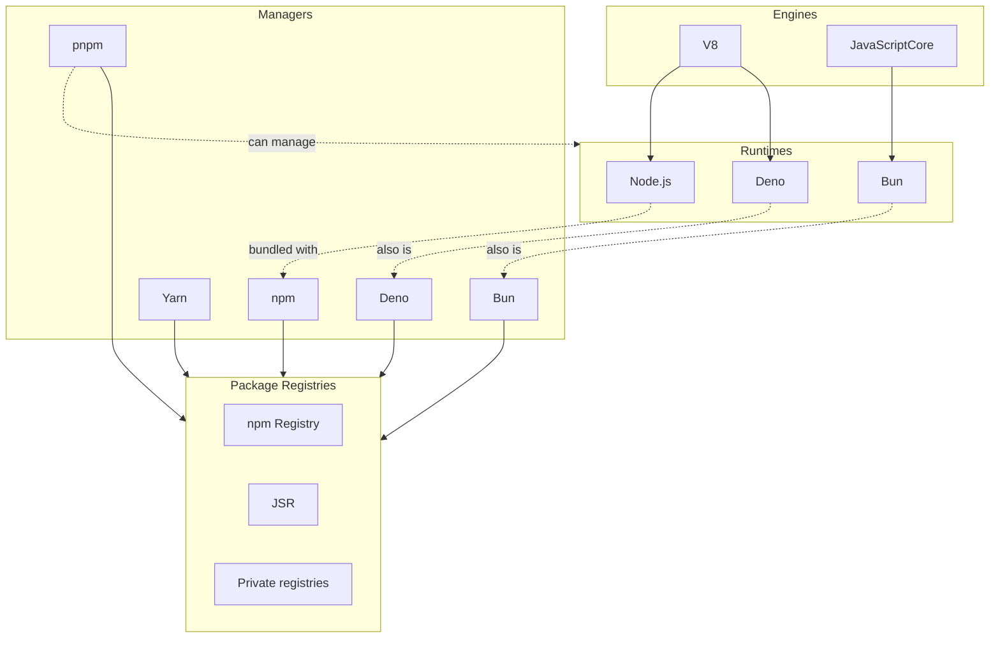

[Node.js](https://nodejs.org) (also Node) is a JavaScript runtime environment aimed at creating servers, web applications, command line tools, and scripts. In modern development, it's become ubiquitous throughout a multitude of use cases.

# Layers

While colloquially believed to be synonymous, Node contains multiple conceptual layers that many developers often interact with simultaneously, hence contributing to the confusion and synonymisation of the different layers within Node. While each layer traditionally served a distinct purpose, modern tools have since began to blur the boundaries between the layers for a more integrated tooling and development experience.

## JavaScript engines

JS engines sit at the lowest level and are the core technologies that runtimes are built on. They are responsible for parsing, compiling, and executing JS code — therefore being the foundation for runtimes.

Examples of JS engines in use today:

- [V8](https://v8.dev/) — the JS engine developed by Google, powering Chrome, Node.js, and Deno
- [JavaScriptCore](https://docs.webkit.org/Deep%20Dive/JSC/JavaScriptCore.html) — the JS engine developed by Apple, powering WebKit (including Safari) and Bun

Most developers don't interact directly with JS engines, unless working on internal code, performance optimisation, or to embed JS into other applications.

## Runtimes

Runtimes give the environment in which JS code executes. They build upon engines and usually expose additional application programming interfaces (APIs) that allow the applications running them to interact with the operating system (OS) — things like file access (`fs`) and network requests (`fetch`).

Examples of runtimes in use today:

- [Node.js](https://nodejs.org)
- [Deno](https://deno.com/)
- [Bun](https://bun.sh)

## Package managers

Developers frequently interact with package managers to manage external dependencies. Package managers help to resolve package versions, download dependencies, maintain lockfiles, and make these packages available for use in the application.

Examples of package managers in use today:

- [npm](https://nodejs.org/learn/getting-started/an-introduction-to-the-npm-package-manager) — seen as the default, usually comes distributed with Node.js
- [Yarn](https://yarnpkg.com/)
- [pnpm](https://pnpm.io)
- [Bun](https://bun.sh/docs/pm/cli/install) — has a package manager as part of its integrated toolkit
- [Deno](https://docs.deno.com/runtime/packages/) — has dependency management for npm and JSR packages as part of its integrated toolkit

Package managers can interact with registries — distribution services that host packages. Today, the [npm Registry](https://npmjs.com) and [JSR](https://jsr.io/) are two popular registries that many package managers interact with.

### Corepack

Historically, Node.js bundled npm as its default package manager. Alternative managers like Yarn and pnpm were often installed separately. While this wasn't an issue for most developers, who often used the same version of their package manager of choice globally, some projects required different versions of the same package manager — for example, when Yarn migrated to v2, its v1 files (including the lockfile and configuration) were incompatible, forcing developers to manage both versions of the same manager.

Corepack was introduced to attempt solving that — it allowed individual projects (via their `package.json` files) to declare their preferred package manager and version. Corepack would then intercept with the relevant package manager and provision the requested version.

While it isn't deprecated now, Corepack has since been removed from the Node.js distributed from Node.js 25; previously, it had been bundled together, making it the most convenient way to manage and handle different package managers.

I'm guessing this has to do with the wider evolution of the ecosystem — I was surprised to learn that pnpm now supports different [[#Runtimes|runtimes]] instead of needing to be dependent on Node.js and npm being installed as a requirement.